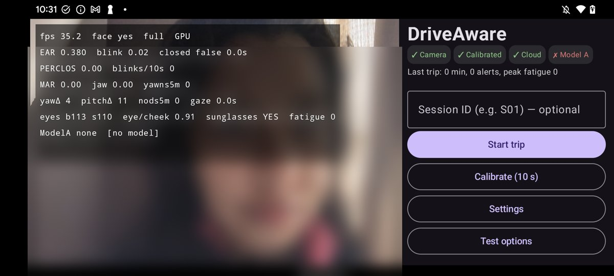
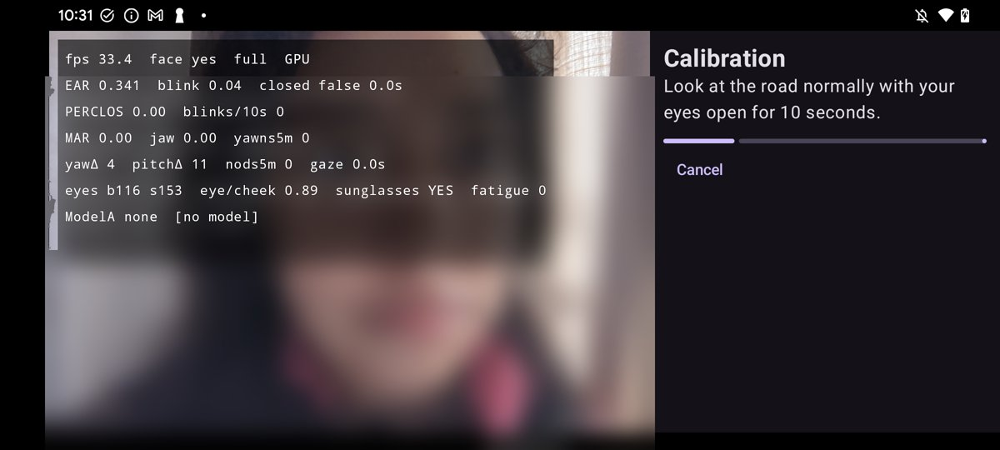
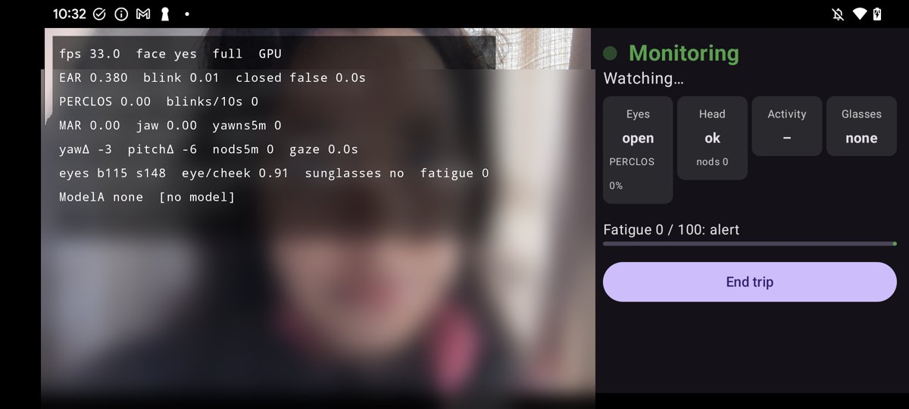
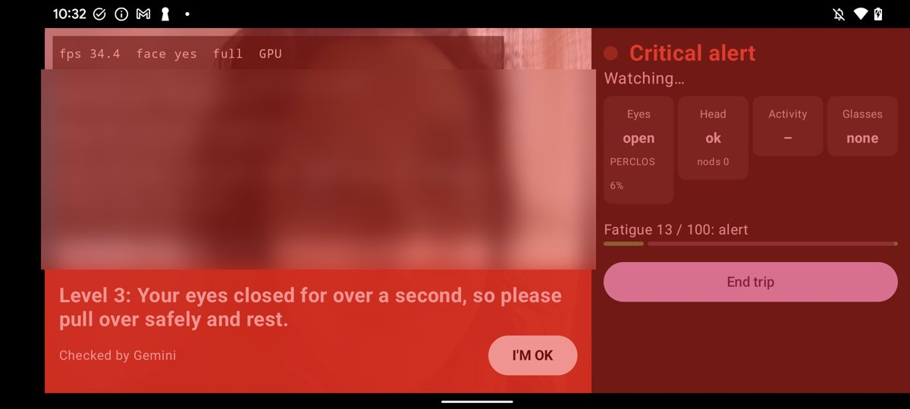
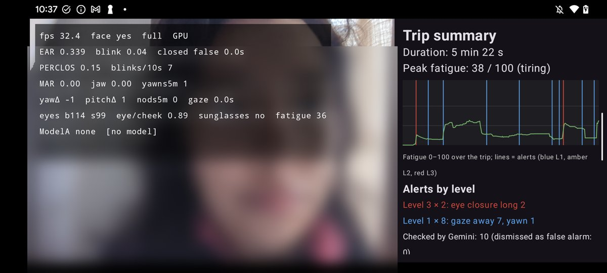
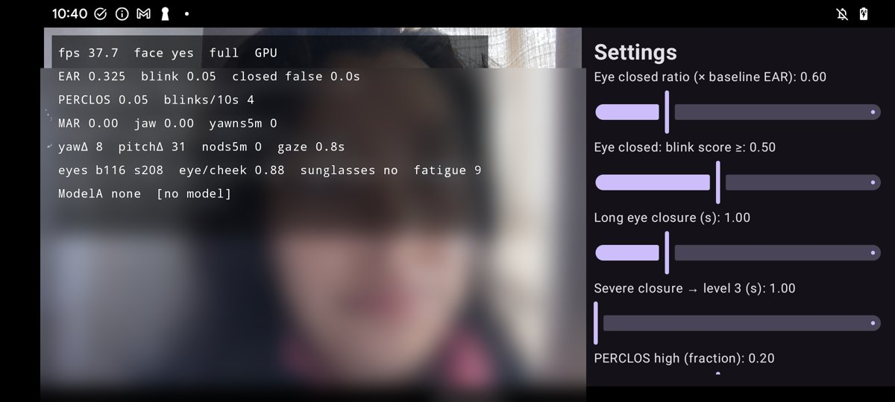

# DriveAware - app

Android app that watches the driver through the front camera and warns about drowsiness and
distraction. CS663 Computer Vision, Project 2 (group: Swathi, Mahitha, Bindu, Vanessa).
Model development code: [`driveaware-models`](https://github.com/PallikalaS/driveaware-models).

📄 Documentation Report PDF: _link after Canvas upload_ · 🎬 Demo video: _YouTube link_

> **Note on screenshots:** the camera view in every screenshot in this README is **blurred on purpose** to protect
> the privacy of the team member being tested. The app itself shows the camera view unblurred; the UI, alerts and
> debug read-outs in the screenshots are unchanged.

## Architecture 

```
Front camera (CameraX 640×480, live) ──► Model C: MediaPipe Face Landmarker   [on device, pretrained]
                                           │ 478 landmarks · blendshapes · head-pose matrix
                                           ▼
                           Signals: EAR, MAR + jawOpen, yaw/pitch/roll
                                           ▼
                Temporal rules: long closure · PERCLOS 60 s · yawn · nod · gaze-away
                                           │
   dynamic upper-body crop ─► Model A: MobileNetV3-Small .tflite   [on device, fine-tuned]
                              phone_use / drinking / smoking / face_touch / safe_driving
                                           ▼
                 Fusion → alert level 1–3 (Level 3 fires locally first)
                                           │ keyframe + 10 s signal summary
                                           ▼
          Cloud Run FastAPI /verify ─► Model B: fine-tuned Gemini 3.5 Flash on Vertex AI  [cloud]
          authority rule · 30 s cooldown · JSON validation · template fallback
                                           ▼
        Chime / spoken message / vibration / red flash · event log · trip summary
```

| Model | What | Where | Customization | Output → next step |
|---|---|---|---|---|
| A | MobileNetV3-Small activity classifier (proposal: EfficientNet-Lite0; Model Maker doesn't install on Colab's Python 3.13) | phone | fine-tuned (State Farm + team clips) | app class + conf → fusion |
| B | Gemini 3.5 Flash (`gemini-3.5-flash`) | Vertex AI endpoint via Cloud Run | supervised fine-tuned (291 train / 56 val examples) | event/confirmed/severity/message/action → alert |
| C | MediaPipe Face Landmarker | phone | pretrained | landmarks/blendshapes/pose → rules |

## 1. App execution instructions

### 1.1 Install the APK (fastest)
1. On an Android phone (Android 8.0+, front camera), download
   **[`driveaware-v0.10.apk`](https://github.com/PallikalaS/driveaware-app/releases/download/v0.10.0/driveaware-v0.10.apk)**
   (74 MB, from the [v0.10.0 release](https://github.com/PallikalaS/driveaware-app/releases/tag/v0.10.0)).
2. Open the file and tap **Install** (allow "Install unknown apps" for your browser or Files app if asked).
3. Open **DriveAware** and allow camera access.
4. Check the chips on Home: **✓ Camera ✓ Calibrated ✓ Cloud ✓ Model A**. ✗ Cloud only means offline:
   every alert still works on the phone, with template messages instead of Gemini's.

### 1.2 Build from source
1. Clone this repo. In Android Studio: **Open** `android/`. Settings → Build Tools → Gradle → **Gradle JDK = 21**
   (Gradle 8.9 does not run on the bundled JDK 25).
2. `bash android/download_assets.sh` fetches `face_landmarker.task` (Model C) into `app/src/main/assets/`.
   Model A (`model_a_v1.tflite` + `model_a_labels.txt`) is already in that folder.
3. Optional, for Gemini: add `backendUrl=<Cloud Run URL>` to `android/local.properties` (not committed, because the
   endpoint calls a paid API; ask Swathi). Without it the app runs offline with local alerts only.
4. **Run ▶** on the emulator (Pixel 6, API 34, front camera = Webcam0) or a phone over USB. Command-line APK:
   `cd android && JAVA_HOME=$(/usr/libexec/java_home -v 21) ./gradlew clean assembleDebug`
   → `app/build/outputs/apk/debug/app-debug.apk`
5. Unit tests: `cd android && ./gradlew test` (rules, sunglasses, activity rules, fatigue score, crop geometry).

### 1.3 Run a trip
1. **Calibrate (10 s)**: sit normally and look at the road; this sets your eye and head-pose baseline.
2. Optionally type a session ID (S01…), then **Start trip**. Mount the phone on the dashboard in landscape,
   with face, both hands and lap in view.
3. Alerts: **Level 1** beep · **Level 2** beep + vibration + voice · **Level 3** alarm + strong vibration +
   full-screen red flash (fires on the phone first, never waits for the cloud). Tap **I'M OK** to clear an alert.
4. **End trip** → trip summary: fatigue chart, alerts by level, Gemini-written trip note, **Export event log** (CSV).
5. **Settings**: every threshold as a slider (saved on the phone). **Test options**: ablation mode
   (rules / rules + Model A / full), debug overlay, force Model A output.

### 1.4 Screenshots of the app running
Real phone (v0.9, Nov 14). The camera view is blurred to protect the tester's privacy; the overlay at the top left
is the app's debug read-out (FPS, EAR, PERCLOS, MAR, head pose, sunglasses check, Model A).

| Home | Calibration (10 s) | Monitoring |
|---|---|---|
|  |  |  |
| **Level 3 alert** (eyes closed > 1 s) | **Trip summary** | **Settings** |
|  |  |  |

### 1.5 Backend (cloud part, for reproducing the system)
```bash
cd backend && python3 -m venv .venv && source .venv/bin/activate
pip install -r requirements.txt -r requirements-dev.txt && pytest -q
export CLOUDSDK_ACTIVE_CONFIG_NAME=driveaware   # gcloud config for this project
GCP_PROJECT=driveaware-cs663-swathi bash deploy.sh                       # base gemini-3.5-flash, Vertex "us"
GCP_PROJECT=driveaware-cs663-swathi GEMINI_MODEL=<tuned endpoint> bash deploy.sh   # after tuning
curl -s "$(gcloud run services describe driveaware-backend --region us-central1 --format='value(status.url)')/health"
```
Cloud Run (us-central1, 0–3 instances, 512 MiB) runs as a service account with only Vertex AI User; no keys on the
phone. `/verify` applies the authority rule (measured closures / PERCLOS / nods are never dismissed), a 30 s
cooldown per event type and a template fallback; `/summary` asks the base model for a 2–3 sentence trip note from
counts only. Undeploy after grading: `gcloud run services delete driveaware-backend --region us-central1`.

## 2. Code description

All app code is Kotlin (Jetpack Compose UI, CameraX, MediaPipe Tasks, TensorFlow Lite); the backend is Python
(FastAPI on Cloud Run). Path prefix for the app sources: `android/app/src/main/java/edu/csueb/driveaware/`.

### 2.1 Android app: screens and orchestration
| File | What it contains |
|---|---|
| `MainActivity.kt` | The whole UI in Jetpack Compose. Sets up CameraX (front camera, 640×480, landscape) and feeds frames to Model C. Screens: **Home** (status chips ✓ Camera/Calibrated/Cloud/Model A, session ID, start trip), **Calibration**, **Monitoring** (status tiles for eyes, head, activity, glasses + fatigue bar), **Alert banner** with I'M OK, **full-screen red flash** for Level 3, **Trip summary** (fatigue chart, alerts by level, Gemini note, export), **Settings** (one slider per threshold) and **Test options** (ablation mode, debug overlay, force Model A output). Also draws the recovery chips (face not found, sunglasses, offline) and the debug overlay. |
| `ui/MonitorViewModel.kt` | The "brain" of the app. Holds the UI state and, for every frame: runs the rules engine, runs Model A on every 3rd frame (unless mode = rules only), fuses the results into events and alert levels, plays alerts, sends events to the backend (full mode only), applies Gemini's verdict or the local template message, logs every event, and builds the trip summary. Also handles calibration, the three ablation modes and the "force Model A output" test switch. |

### 2.2 Android app: Model C (face) and Model A (activity)
| File | What it contains |
|---|---|
| `vision/FaceLandmarkerHelper.kt` | **Model C**: wraps the pretrained MediaPipe Face Landmarker in live-stream mode (GPU, CPU fallback). Uses the GPU on phones and the CPU on the emulator (rebuilds on CPU if the GPU fails). Turns each result (478 landmarks, 52 blendshapes, head-pose matrix) into a `FrameSignals` object, and measures eye- and cheek-region brightness for the sunglasses check. |
| `vision/ModelAClassifier.kt` | **Model A**: loads `model_a_v1.tflite` and classifies the upper-body crop into 5 classes (safe_driving, phone_use, drinking, smoking, face_touch). Uses the MediaPipe Image Classifier when the model has metadata, otherwise the plain TFLite interpreter with `model_a_labels.txt` (our run02 model). Reports load errors on the overlay. |
| `signals/CropGeometry.kt` | The Model A input crop: upper-body box around the detected face, padded to a square, 224×224. Same geometry as `crop.py` in the models repo, so the phone sees the same kind of image Model A was trained on. Also maps Model A's subclass scores to the 5 app classes. |

### 2.3 Android app: signals and decision rules (plain Kotlin, unit-tested)
| File | What it contains |
|---|---|
| `signals/FaceSignals.kt` | Geometry on the landmarks: **EAR** (eye aspect ratio), **MAR** (mouth aspect ratio) + the jawOpen blendshape, and **yaw / pitch / roll** from the head-pose matrix. Defines `FrameSignals`, one processed frame. |
| `signals/Calibration.kt` | The 10-second calibration: collects EAR and head pose while the driver looks at the road, and keeps medians (so a blink doesn't skew them) as that driver's baseline. |
| `signals/Thresholds.kt` | Every tunable number in one place (eye closed = 0.6 × baseline EAR, long closure 1 s, PERCLOS ≥ 0.20 over 60 s, yawn MAR 0.45 for 0.8 s, nod 20°, gaze-away 2 s, Model A 0.6 confidence in 70 % of frames over 2 s, sunglasses ratio 0.6 …). Defaults are the values tuned on our validation clips. |
| `signals/TemporalEngine.kt` | The drowsiness/distraction rules over time: blink vs. long eye closure (Level 3 at 1 s), rolling 60 s **PERCLOS**, yawn counter, **nod** detector, **gaze-away** timer (mirror checks under 2 s don't alert), refractory time so one event isn't repeated, and the guards that stop false alerts (no eye-closure alert while yawning, looking away or wearing sunglasses). Outputs `DetectedEvent`s with a level. |
| `signals/ActivityRules.kt` | Rules on Model A's output: an activity event only fires when ≥ 70 % of predictions over 2 s are that class with confidence > 0.6, so one wrong frame can't alert. Also the "hand occupied" flag and the face-touch counter. |
| `signals/Sunglasses.kt` | Sunglasses detection from the eye/cheek brightness ratio with a 3 s hold. While on, eye-based alerts are switched off (the eyes can't be measured) and the app shows "Eye tracking limited: sunglasses". |
| `signals/FatigueScore.kt` | One 0–100 fatigue number for the trip: PERCLOS (40 pts), nods (25), yawns (20) and face touches (15) over their time windows. Drives the fatigue bar and the summary chart. |

### 2.4 Android app: alerts, cloud, logging, settings
| File | What it contains |
|---|---|
| `data/AlertManager.kt` | Plays the tiered alerts: Level 1 chime, Level 2 chime + spoken message + vibration, Level 3 loud alarm + long vibration (+ red flash in the UI). Level 3 fires immediately, never waiting for the network. |
| `data/BackendClient.kt` | Talks to the Cloud Run backend: sends the 512 px keyframe + 10 s signal summary to `/verify` (4 s timeout, one retry) and the trip counts to `/summary`; warms the server up at trip start. Any failure returns null, and the app falls back to its local template messages ("Offline: local alerts only"). No API keys on the phone. |
| `data/EventLogger.kt` | Writes one CSV row per event (time, type, level, source, mode, Model A class/confidence, Gemini verdict, severity, latency, FPS) for each trip; exported from the trip summary and read by the evaluation script in the models repo. |
| `data/SettingsStore.kt` | Saves the thresholds, the calibration baseline and the last trip's summary on the phone (SharedPreferences). |

### 2.5 Android project files
| File | What it contains |
|---|---|
| `android/app/build.gradle.kts` | App module build: Android 8.0+ (minSdk 26, target 34), version 0.10.0, dependencies (CameraX, MediaPipe Tasks Vision, TensorFlow Lite 2.16, Jetpack Compose), reads `backendUrl` from `local.properties` into `BuildConfig`, keeps `.tflite`/`.task` assets uncompressed. |
| `android/build.gradle.kts`, `settings.gradle.kts`, `gradle.properties`, `gradle/wrapper/*`, `gradlew`, `gradlew.bat` | Standard Gradle project setup and the Gradle wrapper (8.9). |
| `android/app/src/main/AndroidManifest.xml` | App manifest: camera, internet, vibration and wake-lock permissions, landscape activity, FileProvider for sharing the exported log. |
| `android/app/src/main/res/values/strings.xml` · `res/xml/file_paths.xml` | App name · folder the FileProvider may share (exported event logs). |
| `android/app/src/main/assets/model_a_v1.tflite` · `model_a_labels.txt` | **Model A** (fine-tuned MobileNetV3-Small, 1.9 MB, float16) and its 5 class names. |
| `android/download_assets.sh` | Downloads the pretrained **Model C** file (`face_landmarker.task`) into the assets folder. |
| `android/app/src/test/.../TemporalEngineTest.kt` | Unit tests for the drowsiness rules: a 1 s eye closure is Level 3, blinks and mirror checks don't alert but a long gaze-away does, nod alone is Level 2, yawns and nods are counted, PERCLOS needs a full 60 s window, no eye-closure alert during a yawn. |
| `android/app/src/test/.../NewRulesTest.kt` | Unit tests for sunglasses detection (eye/cheek ratio, hold time, dark room stays off, eye alerts skipped but nods kept), activity rules (phone held 2 s fires once, flickering or low-confidence output doesn't), face-touch counting, the fatigue score, and the fixes for tester-reported issues (yawn with closed eyes, looking up, eyes closed facing forward). |
| `android/app/src/test/.../CropGeometryTest.kt` | Checks that the phone's crop matches the Python training crop exactly, and that subclass scores add up into the 5 app classes. |

### 2.6 Backend (Cloud Run, Python)
| File | What it contains |
|---|---|
| `backend/app/main.py` | FastAPI app with `/verify` (keyframe + signals → fine-tuned Gemini → verdict), `/summary` (trip counts → base Gemini → 2–3 sentence trip note) and `/health`. Calls Vertex AI with a JSON response schema and minimal thinking; model, location and timeouts come from environment variables. |
| `backend/app/logic.py` | The decision logic, kept separate so it can be unit-tested: builds the prompt (signal line), the **authority rule** (measured eye closure / PERCLOS / nods can never be dismissed by Gemini), the **30 s cooldown** per event type, template messages for offline/timeouts, and the trip-summary prompt. |
| `backend/app/schema.py` | Request/response models (Pydantic): signal summary, verify request, Gemini verdict (event, confirmed, severity, message ≤ 20 words, action), summary request/response. Labels match the models repo exactly. |
| `backend/tests/test_logic.py` · `test_guide_alignment.py` | Unit tests for the authority rule, cooldown, templates and prompt; checks that the backend's rules agree with the labeling guide used to tune Gemini. |
| `backend/Dockerfile` · `.dockerignore` · `deploy.sh` | Container image and the one-command Cloud Run deploy (service account with Vertex AI User only, us-central1). |
| `backend/requirements.txt` · `requirements-dev.txt` | Python dependencies (FastAPI, Uvicorn, Pydantic, google-genai) and test dependencies (pytest, httpx). |

### 2.7 Test data and documentation
| File | What it contains |
|---|---|
| `tests/scripts/S01.csv` … `S08.csv` | The 8 scripted system-test sessions (held-out drivers): every event with its start/end time, type and condition. Ground truth for the full-system evaluation. |
| `tests/validation/V01.csv` … `V04.csv` | Event timings for the validation clips used to tune the thresholds (never the test sessions). |
| `docs/spec_notes.md` | Specs for the report: models, rules, screens, backend and measured numbers. |
| `docs/screenshots/` | App screenshots used in this README (camera view blurred). |
| `reports/weekly-progress-report.md` | Weekly progress reports. |
| `.github/ISSUE_TEMPLATE/` | Bug-report and task templates for GitHub Issues. |

## Status (v0.8, Nov 13)
- ✅ Model C + rules: blink, long closure (no alert from a yawn), PERCLOS, yawn, nod, gaze-away
  (mirror checks < 2 s don't alert), calibration, sunglasses degraded mode (eye/cheek brightness), fatigue score
- ✅ Model A path: classifier wrapper on the upper-body crop every 3rd frame, 70 % / 2 s rule, hand-occupied,
  face-touch counter, force-output test switch (waiting for `model_a_v1.tflite`)
- ✅ All 5 proposal screens, recovery states (face not found after 3 s, sunglasses, offline), event-log CSV
- ✅ Backend live on Cloud Run with base Gemini 3.5 Flash: /verify, /summary (Gemini trip note), /health
- ⏳ Tuned Gemini endpoint, final thresholds from V01–V03, Model A v1, system-test results
